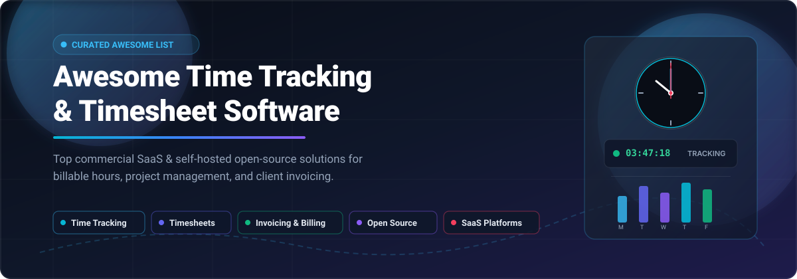

# Awesome Time Tracking & Timesheet Software

  

> A curated list of top Time Tracking and Timesheet Software platforms — both SaaS/Hosted commercial solutions and open-source alternatives for tracking billable hours, managing projects, and generating client invoices.  
> 🌟 Star this repo if you find it useful! 🌟

---

## 📋 Table of Contents

- [SaaS / Hosted Platforms](#-saas--hosted-platforms)
  - [Toggl Track](#toggl-track)
  - [Harvest](#harvest)
  - [Clockify](#clockify)
  - [Hubstaff](#hubstaff)
  - [QuickBooks Time](#quickbooks-time)
  - [Time Doctor](#time-doctor)
  - [Timely](#timely)
  - [Everhour](#everhour)
  - [Paymo](#paymo)
- [Open-Source Software](#-open-source-software)
  - [Kimai](#kimai)
  - [SolidTime](#solidtime)
  - [TimeTagger](#timetagger)
  - [Traggo](#traggo)
  - [Anuko Time Tracker](#anuko-time-tracker)
  - [TimeTracker (DRYTRIX)](#timetracker-drytrix)
- [Comparison at a Glance](#-comparison-at-a-glance)
- [Contributing](#-contributing)

---

## 🟦 SaaS / Hosted Platforms

Commercial, cloud-hosted Time Tracking and Timesheet platforms. These are not open-source but are included as reference points for feature comparison.

### Toggl Track
**Type:** Simple, widely adopted time tracking  
Toggl Track is one of the most recognizable time tracking tools, known for its one-click timer and clean reporting. It offers a free tier for small teams and paid plans with billable rates, project estimates, and integrations. Suited for freelancers and teams wanting frictionless time capture without complex project management overhead.

### Harvest
**Type:** Time tracking with invoicing  
Harvest combines time tracking with invoicing and project budgeting. It is built around structured time entry, project-based reporting, and rate-aware cost tracking. Pricing starts at $9/seat/month on annual plans, with profitability reporting gated to the Enterprise tier. Strengths include straightforward timesheets, approvals, and client project mapping.

### Clockify
**Type:** Free time tracker with unlimited users  
Clockify offers a genuinely free tier with unlimited users and projects, making it a popular starting point for teams. Paid plans add billable rates, invoicing, and advanced reporting. Suited for small teams and startups wanting time tracking without immediate licensing costs.

### Hubstaff
**Type:** Time tracking with productivity monitoring  
Hubstaff combines time tracking with screenshots, activity monitoring, and GPS tracking for remote and field teams. It is often used by agencies and outsourcing firms wanting visibility into distributed work. Pricing is per-user with tiered features.

### QuickBooks Time
**Type:** Time tracking within QuickBooks ecosystem  
QuickBooks Time (formerly TSheets) provides employee time tracking, scheduling, and payroll integration for QuickBooks users. Suited for small businesses already using QuickBooks for accounting who want time data to flow directly into payroll.

### Time Doctor
**Type:** Productivity-focused time tracking  
Time Doctor tracks time with screenshots, website/app usage, and productivity scoring. Positioned for remote teams and outsourcing arrangements where detailed activity monitoring is required. Includes payroll and billing features.

### Timely
**Type:** Automatic time tracking with AI  
Timely uses AI to automatically capture work activity and draft timesheets, reducing manual entry. Positioned for teams wanting accurate time records without the friction of constant timer management. Includes project budgeting and reporting.

### Everhour
**Type:** Time tracking integrated with project tools  
Everhour embeds time tracking directly into tools like Asana, Trello, Jira, and Basecamp, allowing teams to track time without switching applications. Includes budgeting, invoicing, and reporting. Suited for teams already standardized on a project management tool.

### Paymo
**Type:** Work management with time tracking  
Paymo provides tasks, time tracking, and invoices starting at $8.95/month/user, with a free plan for one user. Positioned for freelancers and small studios wanting an all-in-one tool combining project management and time tracking.

---

## 🟩 Open-Source Software

Self-hosted, community-driven Time Tracking and Timesheet tools. All listed projects offer source code you can deploy on your own infrastructure.

### Kimai
**Stack:** PHP / Symfony / MySQL/MariaDB | **License:** AGPL-3.0  
Kimai is the most established open-source time-tracking application, with 5k+ GitHub stars and active maintenance [citation:2][citation:9]. It supports unlimited users with role-based permissions, customer/project/activity management, configurable invoice templates (PDF, DOCX), a JSON API for integrations, and LDAP/SAML authentication [citation:3][citation:10]. Data can be exported in XLSX, PDF, CSV, and HTML formats. Available as both self-hosted (Docker or manual) and a managed SaaS (Kimai Cloud) [citation:3]. Trusted by over 7,000 companies, with a strong reputation for simplicity and reliability [citation:3].  
**Best for:** Freelancers, agencies, and teams wanting a proven, self-hosted time tracker with built-in invoicing and no per-seat fees.

### SolidTime
**Stack:** PHP / Laravel / Vue | **License:** AGPL-3.0  
SolidTime is a modern open-source time tracking application positioned as a self-hosted Toggl alternative, funded through NLnet's NGI0 Commons Fund [citation:11]. It supports multi-organization setups, flexible role- and permission-based user systems, and comprehensive project/task/client management. A native desktop app for macOS, Windows, and Linux adds **automatic activity tracking** with idle detection and local-only privacy — activity stays on the device until converted into a time entry [citation:4]. Built for teams and individuals prioritizing GDPR compliance and data control [citation:11].  
**Best for:** Teams wanting a modern, privacy-first time tracker with desktop auto-tracking and multi-organization support, accepting a younger ecosystem than Kimai.

### TimeTagger
**Stack:** Python / SQLite (Docker) | **License:** Open Source  
TimeTagger is a tag-based time tracker with an **interactive timeline interface** rather than project hierarchies. Users type what they are doing with tags (#writing, #admin, #deep-work), and the timeline visualizes the day as a vertical mirror of activity [citation:6]. Features include powerful reporting by tag or description, CSV/PDF export, Pomodoro integration, a web API, and a CLI tool [citation:13]. The self-hosted Docker version uses a single SQLite database, making backups and migration trivial [citation:6].  
**Best for:** Individuals and freelancers wanting a low-friction, insight-oriented tracker that reveals behavioral patterns without project management overhead.

### Traggo
**Stack:** Go / Docker | **License:** Open Source  
Traggo uses a **tag-based time tracking system** that avoids predefined tasks, allowing highly personalized tracking. Features include customizable dashboards with graphs and statistics, detailed reports filtered by tags and time periods, real-time insights, and multi-device synchronization [citation:5]. Self-hosted with complete data control.  
**Best for:** Users wanting flexible, tag-driven time tracking with customizable visual dashboards, similar in spirit to TimeTagger but with a different UI approach.

### Anuko Time Tracker
**Stack:** PHP / MySQL/MariaDB | **License:** Open Source  
Anuko Time Tracker is a web-based PHP application with a long history and a rich plugin ecosystem [citation:7][citation:14]. Core features include time input by time-of-day or duration, flexible reports (filterable by date, project, activity, person, billable status), and support for 30 languages. Plugins extend functionality with charts, invoicing, expenses, timesheets workflow, custom fields, and report approval [citation:7]. Suitable for individuals through larger organizations with subgroups. Free hosting is available for up to 5 users [citation:14].  
**Best for:** Organizations wanting a proven, plugin-extensible PHP time tracker with invoicing and reporting, deployable on standard LAMP hosting.

### TimeTracker (DRYTRIX)
**Stack:** Python / PostgreSQL/SQLite / Docker | **License:** Open Source  
TimeTracker is a self-hosted time tracking and invoicing platform positioned as a Toggl/Clockify alternative. Features include persistent server-side timers, projects and tasks, **built-in invoicing with PDF and Peppol e-invoicing**, expense tracking, and unlimited users with no per-user pricing [citation:8]. Deploys via Docker Compose on Linux, macOS, Windows (WSL2), Raspberry Pi, or NAS devices. Analytics are privacy-first and opt-in.  
**Best for:** Freelancers and small teams wanting a self-hosted time tracker with invoicing and no user limits, deployable on modest hardware.

---

## 📊 Comparison at a Glance

| Software | License | Stack | Invoicing | Auto-Tracking | Self-Hosted | Best For |
|----------|---------|-------|-----------|---------------|-------------|----------|
| **Toggl Track** | Proprietary | Cloud | ❌ | ❌ | ❌ | Frictionless timer |
| **Harvest** | Proprietary | Cloud | ✅ | ❌ | ❌ | Time + invoicing |
| **Clockify** | Proprietary | Cloud | ✅ (Paid) | ❌ | ❌ | Free unlimited users |
| **Hubstaff** | Proprietary | Cloud | (Payroll) | ✅ (Screenshots) | ❌ | Remote team monitoring |
| **QuickBooks Time** | Proprietary | Cloud | (Payroll) | ❌ | ❌ | QuickBooks ecosystem |
| **Timely** | Proprietary | Cloud | ❌ | ✅ AI | ❌ | Automatic timesheets |
| **Everhour** | Proprietary | Cloud | ✅ | ❌ | ❌ | Embedded in PM tools |
| **Kimai** | AGPL-3.0 | PHP/Symfony | ✅ | ❌ | ✅ | Proven OSS time + invoices |
| **SolidTime** | AGPL-3.0 | PHP/Laravel | (Check) | ✅ Desktop app | ✅ | Privacy-first + auto-tracking |
| **TimeTagger** | Open Source | Python/SQLite | ❌ (Reports) | ❌ | ✅ | Tag-based timeline insights |
| **Traggo** | Open Source | Go | ❌ (Reports) | ❌ | ✅ | Tag-based dashboards |
| **Anuko Time Tracker** | Open Source | PHP/MySQL | ✅ (Plugin) | ❌ | ✅ | Plugin-extensible PHP tracker |
| **TimeTracker** | Open Source | Python/PostgreSQL | ✅ (Peppol) | ❌ | ✅ | Self-hosted Toggl alternative |

---

## 🤝 Contributing

Contributions are welcome! If you know of an open-source Time Tracking or Timesheet tool that should be listed here, please open a pull request with:

- Project name and URL
- Brief description (1–2 sentences)
- Stack and license
- Why it stands out

Please ensure the project is actively maintained (releases within the last 12 months) and genuinely open-source. Note that the open-source ecosystem offers several mature options: Kimai is the most established and feature-complete for invoicing, SolidTime is the most modern with desktop auto-tracking, and TimeTagger/Traggo offer unique tag-based approaches for individuals wanting behavioral insights rather than project billing.

---

## 📄 License

This list is released under CC0 1.0 Universal (Public Domain). The software projects listed retain their respective licenses.

---

⭐ **If this list helped you discover a useful tool, please star the repo!** ⭐
